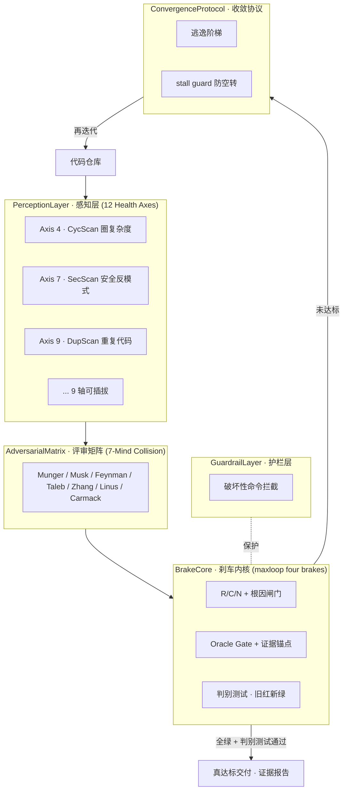

<!-- badges -->
[](LICENSE)
[](https://github.com/huanweide/codehealth-loop/stargazers)
[](https://www.python.org/)
[](https://github.com/huanweide/codehealth-loop)
[](https://github.com/huanweide/maxloop-overlord)
<!-- /badges -->

# codehealth-loop · 工程健康自愈引擎（Panoptes）

> **English TL;DR:** A *self-healing* engineering-health engine. It fuses a brake-driven iteration core (from `maxloop-overlord`), a 12-axis perception layer (from the `doctors` family), a 7-mind adversarial review matrix (from `advverify`), and a destructive-command guardrail (from `forge-safeguard`) into **one systematic loop** that refuses to declare "done" until every health axis is genuinely green — no fake-green, no self-spin.

> **它不是又一个 linter。** 它是把"写代码→假绿→上线→爆雷"的死循环，换成"写代码→多轴体检→对抗评审→带刹车迭代→真达标才交付"的自愈闭环。

---

## 为什么需要它（痛点）

AI 写得动代码，但有三个系统性毛病：

1. **假绿（fake-green）**：测试过了、能跑了，但圈复杂度爆表、重复代码成灾、藏着 `eval` 注入面 —— "能跑" ≠ "该上线"。
2. **没有收敛标准**：改到什么时候算好？全是凭感觉。
3. **空转（self-spin）**：来回改、越改越乱，没人喊停。

`codehealth-loop` 把四件真实武器熔成一条流水线来治这三个毛病：

| 你已有的能力 | 在引擎里的角色 | 来源仓库 |
|---|---|---|
| 带刹车的迭代引擎（四道刹车） | **BrakeCore 刹车内核** | [`maxloop-overlord`](https://github.com/huanweide/maxloop-overlord) |
| 12 个零依赖代码健康轴 | **PerceptionLayer 感知层** | [`doctors` 家族](https://github.com/huanweide/doctors) |
| 7 思维模型对抗评审 | **AdversarialMatrix 评审矩阵** | [`advverify`](https://github.com/huanweide/advverify) |
| 破坏性命令拦截护栏 | **GuardrailLayer 护栏层** | [`forge-safeguard`](https://github.com/huanweide/forge-safeguard) |

> 这就是「合成大西瓜」：**不重新发明轮子，把散落的 4 个项目按一套系统化架构重新编排**。

---

## 架构（系统化概念路线）



**四道刹车（BrakeCore，源自 maxloop）是灵魂：**
1. **R/C/N + 根因闸门** —— 每轮先把红轴收敛成带 `file:line` 证据的根因，不靠感觉。
2. **Oracle Gate + 证据锚点** —— 没有真实判据输出，就不许声称通过。
3. **判别测试（旧红新绿）** —— 上一轮红、这一轮才绿，才算真进步。
4. **逃逸阶梯 + stall guard** —— 卡住就升级策略；连续 N 轮无改善，立即刹车交给人，不空转。

---

## 安装

零第三方依赖，只要本机有 Python ≥ 3.10：

```bash
git clone https://github.com/huanweide/codehealth-loop.git
cd codehealth-loop
python engine.py /path/to/your/project
```

---

## 用法

```bash
# 对任意项目跑自愈闭环（默认最多 6 轮，带 stall guard）
python engine.py ./your-project

# 自定义轮数
python engine.py ./your-project --max-rounds 8
```

真实运行示例（对含缺陷的样例跑，输出有真实 `file:line` 证据）：

```
── Round 1 · health=89 · strategy=standard ──
  • [DupScan] axis9 root-cause @ sample_dirty.py:14 — see findings
  • [SecScan] axis7 root-cause @ sample_dirty.py:11 — see findings
...
══════ DELIVERY (evidence-anchored) ══════
{
  "health_score": 89,
  "verdict": "STALL GUARD tripped — stop self-spin, report to human",
  "axes": [
    {"name":"CycScan","passed":true,"score":100,"evidence":"scanned 2 files, 0 funcs over threshold(>12)"},
    {"name":"DupScan","passed":false,"score":80,"evidence":"2 files, dup-ratio=10.00% (thresh 5%), 1 dup blocks"},
    {"name":"SecScan","passed":false,"score":88,"evidence":"scanned 2 files, 1 hits (1 high)"}
  ]
}
```

> 注意：当前引擎是**诊断 + 收敛 + 证据交付**。自动修复（agent 接 BrakeCore 真去改代码）是路线图 —— 引擎负责"判据真绿才停"，修复动作由上层 agent 在拿到证据报告后执行，二者通过统一接口解耦。

---

## 已实现 vs 路线图（诚实标注）

| 层 | 状态 | 说明 |
|---|---|---|
| BrakeCore 四道刹车 | ✅ 已实现 | `engine.py` 真实跑通 |
| PerceptionLayer · CycScan / SecScan / DupScan | ✅ 已实现（3 轴） | `judges/` 下真实静态分析 |
| PerceptionLayer · 其余 9 轴 | 🔜 可插拔 | 把 `doctors` 家族 12 叶子的检查逻辑抽成 judge 插件 |
| AdversarialMatrix 7 视角 | 🔜 接口预留 | 接入 `advverify` 的多视角评审作为 R/C/N 的对抗输入 |
| GuardrailLayer | 🔜 接口预留 | 接入 `forge-safeguard` 拦截修复时的破坏性命令 |
| 自动修复闭环 | 🔜 路线图 | 上层 agent 消费证据报告 → 改代码 → 再跑引擎 |

---

## 与兄弟项目的关系

- **maxloop-overlord**：本引擎的 BrakeCore 即其四道刹车的 Python 实现。它是"通用迭代质量引擎"，本仓库是它在"代码健康"这一垂直场景的具象化。
- **doctors**：本引擎的 PerceptionLayer 来源。它的 12 个独立零依赖 CLI 将作为**判据插件**被本引擎统一调度（而非各自散落 0★ 仓库）。
- **advverify / forge-safeguard**：分别提供"对抗评审视角"与"执行护栏"，作为可插拔模块。

---

## License

MIT
