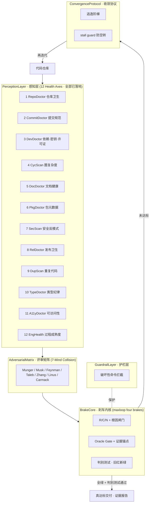

<!-- badges -->
[](LICENSE)
[](https://github.com/huanweide/codehealth-loop/stargazers)
[](https://www.python.org/)
[](https://github.com/huanweide/codehealth-loop)
[](https://github.com/huanweide/maxloop-overlord)
<!-- /badges -->

# codehealth-loop · 工程健康自愈引擎（Panoptes）

> **English TL;DR:** A *self-healing* engineering-health engine. It fuses a brake-driven iteration core (from `maxloop-overlord`), a 12-axis perception layer (from the `doctors` family), a 7-mind adversarial review matrix (from `advverify`), and a destructive-command guardrail (from `forge-safeguard`) into **one systematic loop** that refuses to declare "done" until every health axis is genuinely green — no fake-green, no self-spin.

> **它不是又一个 linter。** 它是把"写代码→假绿→上线→爆雷"的死循环，换成"写代码→多轴体检→对抗评审→带刹车迭代→真达标才交付"的自愈闭环。

---

## 为什么需要它（痛点）

AI 写得动代码，但有三个系统性毛病：

1. **假绿（fake-green）**：测试过了、能跑了，但圈复杂度爆表、重复代码成灾、藏着 `eval` 注入面 —— "能跑" ≠ "该上线"。
2. **没有收敛标准**：改到什么时候算好？全是凭感觉。
3. **空转（self-spin）**：来回改、越改越乱，没人喊停。

`codehealth-loop` 把四件真实武器熔成一条流水线来治这三个毛病：

| 你已有的能力 | 在引擎里的角色 | 来源仓库 |
|---|---|---|
| 带刹车的迭代引擎（四道刹车） | **BrakeCore 刹车内核** | [`maxloop-overlord`](https://github.com/huanweide/maxloop-overlord) |
| 12 个零依赖代码健康轴 | **PerceptionLayer 感知层** | [`doctors` 家族](https://github.com/huanweide/doctors) |
| 7 思维模型对抗评审 | **AdversarialMatrix 评审矩阵** | [`advverify`](https://github.com/huanweide/advverify) |
| 破坏性命令拦截护栏 | **GuardrailLayer 护栏层** | [`forge-safeguard`](https://github.com/huanweide/forge-safeguard) |

> 这就是「合成大西瓜」：**不重新发明轮子，把散落的 4 个项目按一套系统化架构重新编排**。

---

## 架构（系统化概念路线）



**四道刹车（BrakeCore，源自 maxloop）是灵魂：**
1. **R/C/N + 根因闸门** —— 每轮先把红轴收敛成带 `file:line` 证据的根因，不靠感觉。
2. **Oracle Gate + 证据锚点** —— 没有真实判据输出，就不许声称通过。
3. **判别测试（旧红新绿）** —— 上一轮红、这一轮才绿，才算真进步。
4. **逃逸阶梯 + stall guard** —— 卡住就升级策略；连续 N 轮无改善，立即刹车交给人，不空转。

---

## 安装

零第三方依赖，只要本机有 Python ≥ 3.10：

```bash
git clone https://github.com/huanweide/codehealth-loop.git
cd codehealth-loop
python engine.py /path/to/your/project
```

---

## 用法

```bash
# 对任意项目跑自愈闭环（默认最多 6 轮，带 stall guard）
python engine.py ./your-project

# 自定义轮数
python engine.py ./your-project --max-rounds 8
```

真实运行示例：引擎对自身源码跑一轮闭环（`python engine.py .`），12 轴全部真实跑通、输出真实证据，并通过判别测试 —— 工具严于律己：

```
══════ DELIVERY (evidence-anchored) ══════
{
  "round": 1,
  "health_score": 97,
  "verdict": "ALL GREEN + discrimination test passed",
  "axes": [
    {"name":"RepoDoctor","passed":true,"score":100,"evidence":"scanned N files; 0 finding(s); has-license=y; has-readme=y"},
    {"name":"CommitDoctor","passed":true,"score":100,"evidence":"no git history — commit-message hygiene not applicable (manual)"},
    {"name":"DevDoctor","passed":true,"score":100,"evidence":"... 0 finding(s); dependency-cycles=MANUAL"},
    {"name":"CycScan","passed":true,"score":100,"evidence":"scanned N files, 0 funcs over threshold(>12)"},
    {"name":"DocDoctor","passed":true,"score":90,"evidence":"scanned 1 Markdown file(s); 0 finding(s)"},
    {"name":"PkgDoctor","passed":true,"score":100,"evidence":"no package.json in scope — axis not applicable"},
    {"name":"SecScan","passed":true,"score":100,"evidence":"scanned N files, 0 hits (0 high)"},
    {"name":"RelDoctor","passed":true,"score":100,"evidence":"RelDoctor: version=None; 0 finding(s)"},
    {"name":"DupScan","passed":true,"score":92,"evidence":"... dup-ratio=0.00% (thresh 5%), 0 dup blocks"},
    {"name":"TypeDoctor","passed":true,"score":100,"evidence":"scanned 0 TS/JS file(s); 0 type-smell(s)"},
    {"name":"A11yDoctor","passed":true,"score":100,"evidence":"scanned 0 file(s); 0 a11y finding(s)"},
    {"name":"EngHealth","passed":true,"score":96,"evidence":"EngHealth process signals: LICENSE=y, README=y, CI=n, tests=n"}
  ]
}
```

> 注入样例（带 `eval` 的脏文件）时，引擎第 1 轮即 `CONVERGED`：`Healer` 在沙箱副本上清空该行并重跑 `SecScan`，证明变绿 → 标 `verified_green` 交付，**绝不自动改你的代码**。无机械可验证修复的结构性问题（如高圈复杂度）则标 `manual` 诚实移交人工。

> 闭环不是空谈：引擎发现红轴 → `Healer` 生成修复候选 → 在**沙箱副本**上重跑该轴，证明"移除该危险调用确实让轴变绿"（判别测试锁死）→ 交付已验证的修复补丁。**它绝不自动改你的代码**（符合 `forge-safeguard` 安全精神），只把"经证明有效的修复"交给你/上层 agent 落地。若无可机械验证的修复（如高圈复杂度需重构），则标 `manual` 并诚实移交人工。

---

## 已实现 vs 路线图（诚实标注）

| 层 | 状态 | 说明 |
|---|---|---|
| BrakeCore 四道刹车 | ✅ 已实现 | `engine.py` 真实跑通 |
| PerceptionLayer · **全部 12 轴** | ✅ **已实现（本次合成）** | `judges/` 下 12 个真实静态探针：`doctors` 8 轴（Repo/Commit/Dev/Doc/Pkg/Rel/Type/A11y）+ SecScan/CycScan/DupScan 3 轴 + EngHealth 过程轴；零依赖、离线、确定性，继承 dogfood 纪律（不误伤字符串/注释/正则） |
| **Healer Layer（修复候选 + 沙箱验证）** | ✅ **已实现** | `healer.py`：生成修复候选 → 沙箱副本重跑判据证明变绿 → 交付；绝不自动改用户代码 |
| AdversarialMatrix 7 视角 | 🔜 接口预留 | 接入 `advverify` 的多视角评审作为 R/C/N 的对抗输入 |
| GuardrailLayer | 🔜 接口预留 | 接入 `forge-safeguard` 拦截修复时的破坏性命令 |
| 自动落地修复到用户代码 | ❌ 不提供（安全铁律） | 引擎只交付"经沙箱验证的修复候选"，落地由上层 agent/人执行，二者解耦 |

---

## 与兄弟项目的关系

- **maxloop-overlord**：本引擎的 BrakeCore 即其四道刹车的 Python 实现。它是"通用迭代质量引擎"，本仓库是它在"代码健康"这一垂直场景的具象化。
- **doctors**：本引擎的 PerceptionLayer 来源。它的 8 个零依赖 doctor（`repo/commit/dev/doc/pkg/rel/type/a11y`）检查逻辑已**忠实移植**为 `judges/` 下的 Python 探针（第 1/2/3/5/6/8/10/11 轴）；原散落的 9 个独立叶子仓（cycscan/dupscan/secscan/debtlens/debugdoctor/ghadoctor/litdoctor/enghealth/family-showcase）因已被本引擎覆盖，已**归档**到 `gh-optimizer/_archive/`（可逆，不删除），不再各自 0★ 散落。
- **advverify / forge-safeguard**：分别提供"对抗评审视角"与"执行护栏"，作为可插拔模块。

---

## License

MIT
